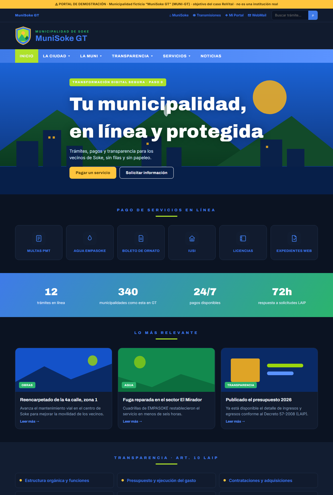

<h1 align="center">ReVital</h1>

<p align="center">
  <b>El paso 0 de la transformación digital segura.</b><br>
  Se suelta sobre un sistema legacy, <b>documenta</b> qué tecnología tiene (aunque nadie sepa),
  dice <b>qué parchear primero</b> según lo que ya se está explotando (CISA KEV) y lo <b>vigila</b> —
  sin tocar ni una línea del sistema viejo.
</p>

<p align="center">
  
  
  
  
  
  
</p>

---

## El problema

Miles de municipalidades, clínicas y oficinas públicas en Guatemala dependen de sistemas de hace 10–20 años:

- **Nadie sabe qué tienen adentro** — el proveedor desapareció, no hay documentación.
- **No saben qué parchear** — hay miles de CVE; sin inventario es imposible priorizar.
- **No pueden reescribirlo** — no hay presupuesto ni tiempo, y el sistema "funciona".

Resultado: sistemas expuestos con vulnerabilidades **que ya se están explotando hoy**, y nadie con la información para actuar.

> **Usuario concreto:** el/la jefe(a) de TI de una municipalidad que heredó un portal viejo sin documentación.
> **La tarea que le devolvemos:** *"saber qué corre en mi institución y qué parchear primero, sin romper lo que ya funciona."*

---

## Cómo funciona — 3 capas sobre el mismo sistema, sin tocarlo

```
   ┌── CAPA 1 · DOCUMENTAR ───────────────────────────────────────────┐
   │  colectores (solo lectura) → inventario común                     │
   │    web (crawler)   red (hosts)   codigo (carpeta)   host (Windows)│
   └───────────────────────────────┬──────────────────────────────────┘
                                    ▼
   ┌── CAPA 2 · PRIORIZAR ─────────────────────────────────────────────┐
   │  componente+versión → CVE (NVD) → ¿está en CISA KEV? → prioridad   │
   │  parche + mitigación + regla WAF sugerida, por vulnerabilidad      │
   └───────────────────────────────┬──────────────────────────────────┘
                                    ▼
   ┌── CAPA 3 · VIGILAR ───────────────────────────────────────────────┐
   │  panel local (ver/descargar) + sentinela (revisa y avisa de cambios)│
   └───────────────────────────────────────────────────────────────────┘
```

Todo es **determinístico y auditable** (no es un chatbot): detección de versiones + cruce con catálogos oficiales. Cada hallazgo trae **evidencia** (de dónde se detectó) y el **parche** oficial según NVD.

---

## Pruébalo en 2 minutos

Caso de demo incluido: **MuniSoke GT**, un portal municipal ficticio sobre Drupal 7.57 + Apache 2.4.49 (ambos con CVE en CISA KEV usados en ransomware).

```bash
# 1) Levanta el objetivo legacy (solo local, aislado)
cd casos/portal-muni-gt/docker && docker compose up -d --build && bash instalar_drupal.sh

# 2) Capa 1 — documenta el sistema
python -m revital.crawler http://localhost:8080 --entidad MUNI-GT --out salida

# 3) Capa 2 — cruza con KEV y dice qué parchear primero
python -m revital.cves --out salida --entidad MUNI-GT

# 4) Capa 3 — ábrelo en el panel
python -m revital.panel --abrir
```

¿Sin Docker? Prueba el pipeline sin red:
```bash
python -m revital.cves --demo      # caso MUNI-GT con catálogos de ejemplo → termina en "ok"
```

<p align="center"></p>

---

## Qué está construido

| Pieza | Estado |
|---|---|
| Capa 1 — colectores web, red, código y host (Windows) | ✅ |
| Capa 2 — cruce NVD/KEV offline + Exploit-DB, prioridad y reporte | ✅ |
| Capa 3 — panel local + sentinela (monitoreo y alertas) | ✅ |
| Caso de demo MuniSoke GT (Drupal 7.57 + Apache 2.4.49 en Docker) | ✅ |
| Parche virtual activo (proxy que bloquea el exploit en vivo, 403) | 🔜 Fase 2 (propuesto) |

> **Alcance honesto:** ReVital detecta **CVEs de software con versión conocida** y los prioriza por CISA KEV.
> No busca bugs de aplicación a medida (SQLi/XSS); para eso se usa un escáner DAST aparte.

---

## Por qué importa en Guatemala (contexto a verificar antes del pitch)

- **ONU — E-Government Survey 2024:** EGDI puesto 122/193.
- **BID + OEA + Oxford (dic-2025):** arquitecturas *legacy* y mala documentación entre las brechas más severas de la región.
- **Ataques 2026 al sector público** muestran que el problema ocurre hoy.
- **Ley Marco de Ciberseguridad (Decreto 26-2026):** plazos de reporte de incidente (30 min / 6 h / 72 h) → justifican la Capa 3.

> Verificar cada cita y cifra contra la fuente primaria antes de presentarla.

---

## Referencia técnica

### Contrato común (`revital/inventory.py`)
`{kind, target, entidad, generado, components:[{producto, version, fuente, donde}], extra:{}}`
Cada colector solo llena `components`; nadie lee el JSON de otro más allá de esto. Es lo que mantiene las piezas desacopladas.

### Colectores (Capa 1)
```bash
python -m revital.crawler https://app.interna.gob --insecure --entidad MINFIN   # web
python -m revital.red 192.168.1.0/24 --entidad MINFIN --autorizo                # red (banners; --autorizo obligatorio)
python -m revital.codigo C:\inetpub\portal --entidad MINFIN                     # carpeta de app legacy
scripts\revital-host.bat MI-INSTITUCION                                          # equipo Windows viejo (solo lectura)
```

### Evaluación (Capa 2)
```bash
python -m revital.cves --out salida --entidad MINFIN   # reporte-<entidad>.md + hallazgos-<entidad>.json
python -m revital.cves --actualizar                    # baja el NVD completo de los productos de alias.json (internet)
```
Prioridad: **1** KEV + ransomware · **2** KEV con fecha límite vencida · **3** KEV · **4** exploit público (Exploit-DB) · **5** CVSS ≥ 9 · **6** CVSS ≥ 7 · **7** resto. Soportar un producto nuevo = agregarlo en `revital/cves/alias.json`.

### Panel y sentinela (Capa 3)
```bash
python -m revital.panel --abrir                       # http://127.0.0.1:8765 — SOLO este equipo (hallazgos sensibles)
python -m revital.sentinela --config sentinela.json   # revisa cada N minutos y avisa de cambios
```
El panel es sin JavaScript, sin internet y sin librerías (corre en equipos viejos). Para verlo desde otra máquina, usa un túnel (`ssh -L 8765:127.0.0.1:8765 host`), no lo expongas: devuelve 403 a cualquier host que no sea localhost, a propósito.

### Caso de demo
`casos/portal-muni-gt/` — ficha del caso, `docker/` (el objetivo), `branding/` (portada MuniSoke GT) e `inventario-esperado.json`.

---

## Reglas de diseño (no se negocian)
1. **Solo stdlib de Python 3.8+** — para correr en el equipo viejo del cliente (Windows 7), sin instalar nada.
2. **Offline** — los catálogos KEV/NVD viajan con la herramienta; la demo no depende del Wi-Fi.
3. **Solo lectura** — ReVital nunca modifica el sistema analizado.
4. **Solo contra sistemas propios o con autorización por escrito.**

## Equipo y flujo
Hecho por el equipo **ReVital** (UVG, Guatemala) — ver [contribuidores](https://github.com/Zairocode/ReVital/graphs/contributors).
Ramas cortas, PR a `main`, commits pequeños; los cambios al contrato van primero a `main`.

<p align="center"><sub>Proyecto de hackathon · Track 03 Legacy · uso educativo y defensivo.</sub></p>
