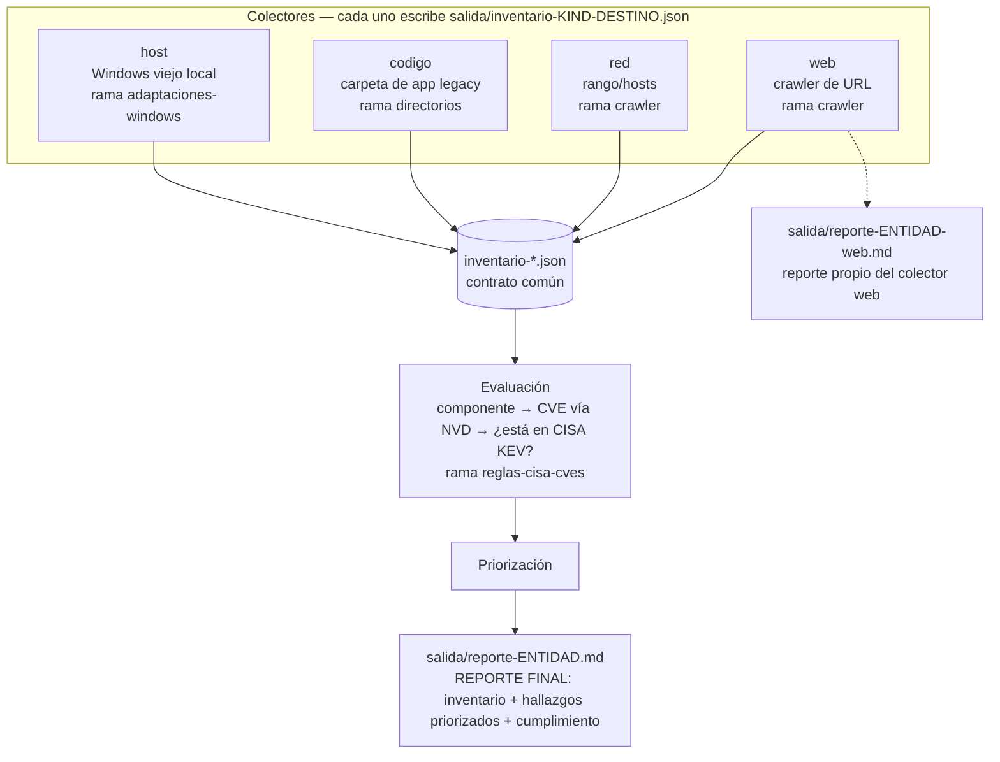

# ReVital — explicado para el equipo

> Documento de contexto para los 6 integrantes. Léelo completo una vez; después úsalo como referencia.
> Resumen visual de 1 hoja: [`ReVital-resumen-1-hoja.pdf`](ReVital-resumen-1-hoja.pdf).
> Fuente de verdad técnica: el `README.md` y `revital/inventory.py` de `main` (diseño de Zairocode) y el código de cada rama. Si este documento y el código no coinciden, manda el código y se corrige este archivo.
> Alineado con: `main` @ `c1b013c` y `crawler` @ última versión (21-nov-2026). El colector web (§7.1) ya fue probado contra el caso `portal-muni-gt` (Docker).
> Lo marcado como **(propuesta)** no está decidido en el README; se valida con el equipo.

---

## 1. La idea en una frase

**ReVital se suelta sobre una app, un servidor o una institución, documenta qué tecnología tiene (aunque sea vieja) y dice qué vulnerabilidades del catálogo CISA KEV hay que parchear primero.** Entrega un `.md`/`.txt` por entidad con el inventario, los hallazgos priorizados y el estado de cumplimiento.

No toca, no reescribe y no reemplaza el sistema viejo: solo lo **mira** y lo **explica**.

### Estado actual (21-nov)

| Pieza | Rama | Archivo | Estado |
|---|---|---|---|
| Contrato común | `main` | `revital/inventory.py` | ✅ listo |
| Colector web | `crawler` | `revital/crawler.py` + `tests/test_crawler_local.py` | ✅ funcionando, con pruebas que pasan |
| Colector de red | `crawler` | `revital/red.py` | ⏳ por hacer |
| Colector de código/carpeta | `directorios` | `revital/codigo.py` + `tests/test_codigo.py` | ✅ funcionando, probado con el código real de Drupal 7.57 |
| Colector de host Windows | `adaptaciones-windows` | `revital/host.py`, `scripts/` | ⏳ por hacer |
| Catálogos KEV/NVD congelados (offline) | `main` | `catalogos/`, `scripts/actualizar_catalogos.py`, `tests/test_catalogos.py` | ✅ listo |
| Objetivo de demo (Drupal 7.57 + Apache 2.4.49) | `main` | `casos/portal-muni-gt/` | ✅ levanta con Docker; `instalar_drupal.sh` + `verificar.sh` |
| Evaluación KEV/NVD + reporte final | `reglas-cisa-cves` | `revital/cves/` | ⏳ por hacer (los catálogos ya están listos para consumirse) |

---

## 2. ¿Qué problema resolvemos y para quién?

### El problema
Muchas oficinas públicas, municipalidades, clínicas y empresas en Guatemala dependen de sistemas de hace 10–20 años:

- **Nadie sabe qué tienen adentro.** El proveedor desapareció, no hay documentación, el que lo instaló ya no trabaja ahí.
- **No saben qué parchear.** Existen miles de CVE publicados; sin inventario es imposible saber cuáles les afectan.
- **No pueden reescribirlo.** No hay presupuesto ni tiempo; el sistema "funciona" y no se puede apagar.

El resultado: sistemas expuestos con vulnerabilidades que **ya se están explotando en el mundo real**, y nadie con la información para actuar.

### El usuario concreto
**El/la jefe(a) de TI de una municipalidad o entidad pública** que heredó un portal o servidor viejo sin documentación. Hoy, para saber "¿qué tengo y qué debo arreglar primero?", tendría que revisar a mano servidor por servidor y cruzar versiones contra bases de datos de vulnerabilidades. Con ReVital corre un comando y obtiene la respuesta en un reporte.

### La tarea que le devolvemos
> "Saber qué tecnología corre en mi institución y qué parchear primero, sin tocar ni romper lo que ya funciona."

---

## 3. ¿Por qué encaja en el Track 03 Legacy?

| Lo que pide el track | Cómo lo cumple ReVital |
|---|---|
| Conectar un sistema antiguo con tecnología actual | Conecta sistemas viejos con el catálogo actual de amenazas (CISA KEV / NVD) |
| Que alguien recupere una tarea | El jefe de TI recupera la tarea de inventariar y priorizar parches |
| Sin perder sus datos ni lo que ya tenía | Solo lectura: no modifica nada del sistema analizado |
| Traer la tecnología original, quién la usa y qué limitación resuelve | App legacy de prueba (ej. IIS 6 / ASP.NET, Apache viejo, jQuery 1.x) + jefe de TI + "no sabe qué tiene ni qué parchear" |
| **NO** rehacer el sistema desde cero con otra cara | No rehacemos nada: documentamos y recomendamos |
| "Ningún track se gana con un chatbot pegado encima" | El núcleo es determinístico: detección de versiones + cruce con catálogos. No es un chat |

---

## 4. Conceptos que todos deben dominar (glosario)

- **Legacy:** sistema viejo que sigue en producción, normalmente sin soporte ni documentación.
- **CVE** (*Common Vulnerabilities and Exposures*): identificador único de una vulnerabilidad pública, ej. `CVE-2021-41773`.
- **NVD** (*National Vulnerability Database*, NIST): base de datos que dice **qué productos y versiones** afecta cada CVE (mediante identificadores CPE) y su severidad (CVSS).
- **CISA KEV** (*Known Exploited Vulnerabilities*): lista de la agencia de ciberseguridad de EE. UU. con los CVE que **se sabe que están siendo explotados activamente**. Es un subconjunto pequeño de todos los CVE, por eso sirve para priorizar. Se publica como JSON: <https://www.cisa.gov/sites/default/files/feeds/known_exploited_vulnerabilities.json>. Campos útiles por entrada: `cveID`, `vendorProject`, `product`, `vulnerabilityName`, `dateAdded`, `shortDescription`, `requiredAction`, `dueDate`, `knownRansomwareCampaignUse`.
- **CPE:** nombre estandarizado de un producto/versión (ej. `cpe:2.3:a:apache:http_server:2.4.49`). Es el "puente" entre lo que detectamos y lo que dice NVD.
- **Colector:** módulo que inspecciona una fuente (web, red, carpeta, equipo) y produce un inventario.
- **Inventario:** lista de componentes detectados (`producto` + `version`) con el formato común del proyecto.
- **Entidad:** la institución analizada (ej. `MINFIN`, `MUNI-COBAN`); agrupa los reportes.

---

## 5. Arquitectura



Versión texto (por si el visor no muestra Mermaid):

```
 colectores (cada uno -> salida/inventario-<kind>-<destino>.json)
   web     : crawler de URL                       (rama crawler)
   red     : rango/hosts de una institución       (rama crawler)
   codigo  : carpeta de una app legacy            (rama directorios)
   host    : equipo/servidor Windows viejo local  (rama adaptaciones-windows)
        │
        ▼
 evaluación: componentes -> CVE (NVD) -> ¿en CISA KEV?    (rama reglas-cisa-cves)
        │
        ▼
 reporte por entidad: salida/reporte-<entidad>.md
   inventario + hallazgos priorizados + cumplimiento
```

**Dos niveles de reporte:**
- **Por colector** (documentación de lo que vio ese colector). Hoy el crawler ya genera `salida/reporte-<entidad>-web-<destino>.md` con componentes, documentos enlazados, páginas y formularios.
- **Final por entidad** `salida/reporte-<entidad>.md`: lo genera la evaluación uniendo todos los inventarios y agregando los CVE/KEV priorizados.

### Restricciones de diseño (no se negocian)
1. **Solo biblioteca estándar de Python 3.8+.** Nada de `pip install`. Razón: tiene que correr en el equipo viejo del cliente (Windows 7 incluido) donde no podemos instalar nada. Ojo: **3.8 es la última versión de Python que instala en Windows 7**, así que el código no puede usar nada más nuevo que 3.8 (ej. nada de `match`, ni `str.removeprefix` de 3.9).
2. **Offline.** Los catálogos KEV y NVD ya están congelados en `catalogos/` (ver `catalogos/LEEME.md`); se refrescan con `python scripts/actualizar_catalogos.py` (~15 s, con internet). En la demo no dependemos del Wi-Fi.
3. **Solo lectura.** Ningún colector modifica el sistema analizado.
4. **Solo contra sistemas propios o con autorización.** Esto se dice también en el pitch.
5. Linux viejo: fuera de alcance por ahora.

---

## 6. El contrato común (lo más importante para que todo encaje)

Está en `revital/inventory.py`. **Todo colector produce exactamente esto** y nadie lee el JSON de otro más allá de estos campos:

```json
{
  "kind": "web | host | red | codigo",
  "target": "https://app.interna.gob  |  C:\\inetpub\\app  |  10.0.0.0/24",
  "entidad": "MUNI-COBAN",
  "generado": "2026-11-21 10:30:00",
  "components": [
    {"producto": "Microsoft-IIS",    "version": "6.0",    "fuente": "header server",      "donde": "https://app.interna.gob/"},
    {"producto": "jquery",           "version": "1.4.2",  "fuente": "script",             "donde": "https://app.interna.gob/login.aspx"},
    {"producto": "Apache Tomcat",    "version": "5.5.23", "fuente": "pagina de error",    "donde": "https://app.interna.gob/nada"},
    {"producto": "ASP.NET WebForms", "version": "",       "fuente": "extension .aspx",    "donde": "https://app.interna.gob/login.aspx"}
  ],
  "extra": {}
}
```

- `producto`: nombre del componente. `version`: vacía si no se conoce.
- `fuente`: **cómo** lo detectamos (header, meta generator, nombre de archivo, pom.xml…). Esto es evidencia: el jurado puede preguntar "¿cómo sabes que es esa versión?".
- `donde`: **en qué lugar** (URL, ruta de archivo, host:puerto).
- `extra`: libre para cada colector (páginas, formularios, puertos…); la evaluación no depende de él.

Funciones disponibles: `nuevo(kind, target, entidad)`, `componente(producto, version, fuente, donde)`, `guardar(inv)` → `salida/inventario-<kind>-<destino>.json`, `cargar_todos()` (lo usa la evaluación).

> **Nombre del archivo:** `guardar()` usa `inventario-<kind>-<destino>.json` (destino = `inventory.slug(target)`, ej. `localhost-8080`). Dos objetivos del mismo tipo no se pisan; volver a correr el mismo objetivo actualiza su archivo. `cargar_todos()` lee todos.

**Regla:** si alguien necesita cambiar el contrato, el cambio va **primero a `main`** y se avisa al equipo.

---

## 7. Qué hace cada pieza

### 7.1 Colector web — rama `crawler` (`revital/crawler.py`) — ✅ funcionando
Ya usa el contrato común: produce `salida/inventario-web-<destino>.json` con `components[]` (producto y versión separados) y además un reporte propio del colector, `salida/reporte-<entidad>-web-<destino>.md`.

**Recorre** las páginas del sitio (solo los hosts permitidos) y **detecta tecnología** por:
- headers `Server`, `X-Powered-By`, `X-AspNet-Version`, `X-AspNetMvc-Version` (ej. `Microsoft-IIS` `6.0`);
- `<meta name="generator">` (ej. `Joomla` `1.5`);
- nombre de los scripts (`jquery-1.4.2.min.js` → `jquery` `1.4.2`);
- extensión de las páginas (`.aspx`, `.asp`, `.jsp`, `.php`, `.cfm`, `.do`, `.action`);
- cookies de sesión (`ASPSESSIONID` → ASP clásico, `JSESSIONID` → Java, `PHPSESSID` → PHP…);
- rutas delatoras (`/WebResource.axd` → ASP.NET, `/wp-content/` → WordPress, `/_layouts/` → SharePoint…);
- versiones filtradas en **comentarios HTML** y **páginas de error** (ej. `Apache Tomcat/5.5.23` en un 404);
- **todos los productos de un header** (`Apache/2.4.49 (Unix) PHP/7.4.33` → Apache **y** PHP);
- **versión exacta del CMS** pidiendo archivos conocidos: `/CHANGELOG.txt` (Drupal), `/readme.html` (WordPress), `joomla.xml` (Joomla). Necesario porque el meta generator de Drupal 7 solo dice "Drupal 7";
- **servidor de enfrente tras un proxy:** el header `Server` de las páginas es el del backend; el crawler provoca un error 400 (URL mal formada) que contesta el propio proxy y ahí aparece su versión real (ej. Apache 2.4.49 delante de un backend 2.4.10);
- **metadatos de documentos:** de PDF y DOCX/XLSX/PPTX lee el software que los creó (ej. `Microsoft Office Word 12.0`), que revela versiones;
- `robots.txt` y `sitemap.xml` como fuente de rutas (los `Disallow` suelen apuntar a `/admin`, `/backup`; se listan en el reporte);
- **charset real** de cada página (header, `<meta>`, UTF-8 y, si no cuadra, latin-1).

Cada componente queda con su `fuente` (ej. `header server`, `cookie aspsessionid`, `pagina de error`) y `donde` (URL).

**Robustez para sitios legacy:**
- **Scope:** no sigue enlaces ni redirecciones a hosts no autorizados (ni siquiera los contacta). Hosts extra con `--scope`.
- **Anti-trampas:** limita URLs repetitivas tipo `/ver?id=1,2,3…` y quita ids de sesión de las URL para no recorrer la misma página mil veces.
- **Reintentos** ante fallos de red; los errores HTTP 4xx/5xx se guardan (sirven como evidencia).
- `--insecure` para TLS 1.0 / certificados vencidos o autofirmados.
- `Ctrl+C` guarda lo recorrido hasta ese momento.

**En `extra`** guarda las páginas (estado, título, formularios y sus campos), los **documentos enlazados** (`.pdf`, `.doc`, `.xls`…) y los hosts permitidos: eso es la "documentación" de la app.

**Pruebas:** `python -m revital.crawler --demo` (parser, sin red) y `python tests/test_crawler_local.py` (levanta un sitio legacy falso local con trampas, redirect externo, página de error, sitemap, PDF y CHANGELOG de Drupal).

**Probado contra el caso real (`casos/portal-muni-gt`, Docker):** detecta Drupal 7.57 (`/CHANGELOG.txt`), Apache 2.4.49 (proxy, error 400), Apache 2.4.10 y PHP 7.0.28 (backend) y las 36 rutas de `robots.txt`.

**TLS viejo:** con `--insecure` el crawler baja hasta TLS 1.0 (Python moderno exige 1.2 por defecto) y, en cada `https`, prueba TLS 1.3/1.2/1.1/1.0 por separado. Si el servidor acepta 1.0 o 1.1 queda como componente `TLS` (protocolo obsoleto) y en una sección del reporte. Probado con servidores locales de prueba en Python 3.8 + OpenSSL 1.1.1; **no** probado en un Windows 7 real.

**Pendiente del colector:** login y JavaScript.

> **Nombres de producto:** el crawler emite los nombres tal como los ve (`Apache`, `Drupal`, `PHP`, `Microsoft-IIS`). El cruce con NVD/CPE (`apache http_server`, `drupal`, `php`) necesita la **tabla de alias** de §7.5; hay que acordarla entre `crawler` y `reglas-cisa-cves`.

### 7.2 Colector de red — rama `crawler` (`revital/red.py`) — ⏳ por hacer
Recorrerá un rango o lista de hosts de la institución y toma banners de servicios (versión de servidor web, etc.). Produce `inventario-red.json`.

### 7.3 Colector de código/carpeta — rama `directorios` (`revital/codigo.py`) — ✅ funcionando
`python -m revital.codigo RUTA_APP --entidad X` recorre la carpeta de una app legacy y lee los archivos que **declaran** versiones (solo lectura, ignora `node_modules`):
- `web.config` (versión de .NET Framework y assemblies; alerta si hay `debug=true` o `customErrors Off`), DLL (`FileVersion`) y JAR (por nombre);
- `pom.xml` (dependencias Java con sus propiedades: aquí aparece, por ejemplo, un Log4j viejo);
- `composer.json`/`composer.lock` (PHP), `package.json`/`package-lock.json` (JS), `requirements.txt` (Python) y `packages.config` (NuGet);
- librerías JS por nombre o por cabecera (jQuery núcleo y jQuery UI; los plugins no se confunden con el núcleo);
- `includes/bootstrap.inc` (versión de Drupal) y `wp-includes/version.php` (WordPress).

Produce `inventario-codigo-<destino>.json` y `reporte-<entidad>-codigo-<destino>.md`. Es el colector con la evidencia más precisa porque lee versiones declaradas, no adivinadas. Contra el código real del caso `portal-muni-gt` da Drupal 7.57, jQuery 1.4.4 y jQuery UI 1.8.7.

### 7.4 Colector de host — rama `adaptaciones-windows` (`revital/host.py`, `scripts/`) — ⏳ por hacer
Correrá en el propio equipo/servidor Windows viejo: software instalado, versión de Windows/IIS, etc. Incluye un `.bat` para lanzarlo fácil y las adaptaciones para TLS y Python viejos. Produce `inventario-host.json`.

### 7.5 Evaluación y reporte — rama `reglas-cisa-cves` (`revital/cves/`) — ⏳ por hacer
1. **Carga** todos los `inventario-*.json` con `cargar_todos()`.
2. **Normaliza** cada `producto`+`version` a algo comparable (idealmente CPE).
3. **Busca CVE** que afecten esa versión en la copia offline de NVD.
4. **Marca** cuáles de esos CVE están en **CISA KEV** (explotados activamente).
5. **Prioriza** — **(propuesta)**, a confirmar por quien lleve la rama:
   1. En KEV **y** `knownRansomwareCampaignUse = "Known"`;
   2. En KEV con `dueDate` ya vencida;
   3. En KEV;
   4. No está en KEV, ordenado por severidad CVSS.
6. **Genera** el reporte final `salida/reporte-<entidad>.md` (une lo de todos los colectores) con: inventario (con fuente y dónde), hallazgos priorizados (CVE, producto afectado, por qué es prioritario, `requiredAction` de CISA) y resumen de cumplimiento (cuántos KEV abiertos).

> Nota honesta: el cruce producto→CVE es la parte más difícil (los nombres detectados no siempre coinciden con los de NVD). Para la demo conviene una **tabla de alias** pequeña y controlada para los productos de nuestra app de prueba.

---

### 7.6 Panel y sentinela — `revital/panel/`, `revital/sentinela.py`
**Panel local** (`python -m revital.panel --abrir`): para el jefe de TI. Muestra por entidad si cumple o no, qué parchear primero (con la acción y fecha límite de CISA), todas las vulnerabilidades con su evidencia, el inventario y la documentación (ver en pantalla, descargar archivo o `.zip`). También lanza análisis (sitio web o carpeta de código) con una casilla obligatoria de autorización. Es solo lectura sobre `salida/`: no calcula nada, muestra lo que producen los colectores y `revital.cves`.
- Solo biblioteca estándar, sin JavaScript ni recursos de internet, para equipos viejos.
- Escucha solo en `127.0.0.1`; rechaza `Host` y `Origin` ajenos; solo sirve archivos de `salida/` (sin `../`); escapa todo el contenido; ejecuta los colectores sin shell.
- No tiene clave porque no sale del equipo. Si algún día se expone en red, hay que agregar clave y HTTPS.

**Sentinela** (`python -m revital.sentinela --config sentinela.json`): cada `cada_minutos` re-analiza los objetivos, evalúa, guarda una foto en `salida/historial/<entidad>/` y compara con la anterior. Detecta componente nuevo o quitado, versión cambiada, KEV nueva o resuelta, cambio de cumplimiento y objetivos que no responden. Escribe `salida/alertas.jsonl` (lo muestra el panel) y, si se configura `al_detectar_cambio`, ejecuta ese comando con `REVITAL_ENTIDAD` y `REVITAL_ALERTAS`. La primera vuelta es solo línea base.
Pruebas: `tests/test_panel.py` y `tests/test_sentinela.py` (verificadas en Python 3.8 + OpenSSL 1.1.1).
## 8. Cómo trabajamos en el repo

| Rama | Carpeta/archivo que toca | Qué |
|---|---|---|
| `crawler` | `revital/crawler.py`, `revital/red.py` | Colector web y de red |
| `directorios` | `revital/codigo.py` (+ `docs/` para documentación compartida) | Colector de carpeta/app |
| `adaptaciones-windows` | `revital/host.py`, `scripts/` | Colector de equipo Windows viejo |
| `reglas-cisa-cves` | `revital/cves/` | Catálogos offline, cruce, prioridad, reporte |

- **Cada rama toca solo su carpeta.** Así no hay conflictos.
- Ramas cortas, **PR a `main`**, commits pequeños.
- Cambios al contrato (`inventory.py`) primero a `main`.
- Documentación compartida del equipo: carpeta `docs/` en la rama `directorios`.
- Pruebas en `tests/` (sin pytest: se corren con `python tests/<archivo>.py`).

### Uso del colector web (lo que ya funciona)
```
python -m revital.crawler https://app.interna.gob --insecure --entidad MUNI-COBAN
python -m revital.crawler --demo                 # autoprueba del parser, sin red
python tests/test_crawler_local.py               # prueba contra un sitio legacy falso local
```

| Opción | Para qué | Por defecto |
|---|---|---|
| `--entidad X` | Nombre de la institución (nombra el reporte) | vacío → `sin-entidad` |
| `--out DIR` | Carpeta de salida | `salida` |
| `--insecure` | Aceptar TLS 1.0 y certificados vencidos/autofirmados | apagado |
| `--scope h1,h2` | Hosts extra permitidos además del de la URL | ninguno |
| `--max N` | Máximo de páginas | 200 |
| `--delay S` | Pausa entre páginas (no saturar el servidor viejo) | 0.5 s |
| `--timeout S` | Tiempo máximo por petición | 15 s |

Salida: `salida/inventario-web-<destino>.json` + `salida/reporte-<entidad>-web-<destino>.md`.

---

## 9. La demo (lo que verá el jurado)

Regla del evento: **"se enseña lo que funciona"**. Guion sugerido **(propuesta)** (≈90 s):

1. **Dolor (15 s):** "Esta es la app de una municipalidad: IIS/Apache viejo, sin documentación, nadie sabe qué tiene. ¿Qué parchean primero?"
2. **Documentar (25 s):** corremos los colectores sobre la app legacy de prueba (en local, sin internet). Aparece el inventario: producto, versión, cómo lo supimos y dónde, más páginas, formularios y documentos encontrados. *(Esta parte ya funciona con el crawler.)*
3. **Priorizar (30 s):** la evaluación cruza contra CISA KEV. Mostramos el reporte: "de N componentes, estos 2 tienen vulnerabilidades que se están explotando hoy; esta es la acción requerida y la fecha límite de CISA".
4. **Prueba de que no tocamos nada (10 s):** hash del sistema antes y después: idéntico.
5. **Cierre (10 s):** "Esto es el paso 0 de cualquier transformación digital: no puedes modernizar lo que no sabes que tienes."

**Preparar antes:**
- App legacy de prueba en local (contenedor o carpeta) con versiones viejas conocidas que **sí** estén en KEV.
- Catálogo KEV y extracto de NVD descargados y congelados en el repo/USB.
- Reporte de ejemplo ya generado como respaldo, y video de respaldo.
- Todo probado en **modo avión**.

---

## 10. Preguntas que nos puede hacer el jurado (y respuesta corta)

- **"¿Eso no lo hace ya Nessus/OpenVAS/Trivy?"** → Son herramientas pesadas, de pago o que requieren instalar dependencias/infraestructura. ReVital corre con Python puro en el equipo viejo del cliente, offline, y prioriza solo con lo que **ya se está explotando** (KEV), en un reporte que entiende un jefe de TI.
- **"¿Cómo saben la versión?"** → Cada componente trae `fuente` y `donde`: evidencia rastreable.
- **"¿Y si la versión no se puede detectar?"** → Se reporta el componente con versión desconocida y se marca para revisión manual; no inventamos.
- **"¿Es legal escanear?"** → Solo sobre sistemas propios o con autorización por escrito.
- **"¿Dónde está la IA?"** → El núcleo es determinístico a propósito (confiable y auditable). La IA puede entrar como apoyo para redactar el resumen ejecutivo o normalizar nombres de productos, nunca para decidir solos qué es vulnerable.

---

## 11. Riesgos y cómo los cubrimos

| Riesgo | Mitigación |
|---|---|
| El cruce producto→CVE no encuentra coincidencias | Tabla de alias controlada para la demo; probar temprano con la app de prueba |
| Cada colector entrega un formato distinto | Contrato único en `inventory.py` (el crawler ya lo cumple; los demás deben copiar su patrón) |
| Código que no corre en Windows 7 | Probar cada colector con Python 3.8 real antes de la demo |
| Sin internet en la UVG | Catálogos offline, todo local |
| Querer cubrir todo (4 colectores) y no cerrar ninguno | Prioridad: **web + código + evaluación + reporte** funcionando de punta a punta; red y host después |
| Afirmar datos que no podemos sostener | En el pitch solo citamos cifras con fuente primaria verificada |

---

## 12. Hoja de ruta (después del MVP) — (propuesta)

No está en el README del repo: son ideas que salieron del análisis previo ("Escudo Legacy 3 Capas") y sirven para responder "¿y después qué?" en el pitch. **No es parte del MVP de hoy** y se valida con el equipo:

- **Fase 2 — Parche virtual:** un proxy delante del sistema viejo que bloquea el vector de ataque del CVE detectado, sin tocar el sistema (probado con exploit → `403` y uso normal → `200`).
- **Fase 3 — Monitoreo y cumplimiento:** panel con intentos bloqueados por CVE, rollback y exportación de reporte de incidente.
- Soporte para Linux viejo.

---

## 13. Checklist rápido para cada integrante

- [ ] Leí este documento y el `README.md`.
- [ ] Sé qué rama es la mía y qué carpeta toco.
- [ ] Mi colector produce el contrato de `inventory.py` (probado con `python -m ...`).
- [ ] Mi código usa solo la biblioteca estándar y corre en Python 3.8.
- [ ] Funciona sin internet.
- [ ] Hice PR a `main` con commits pequeños.
