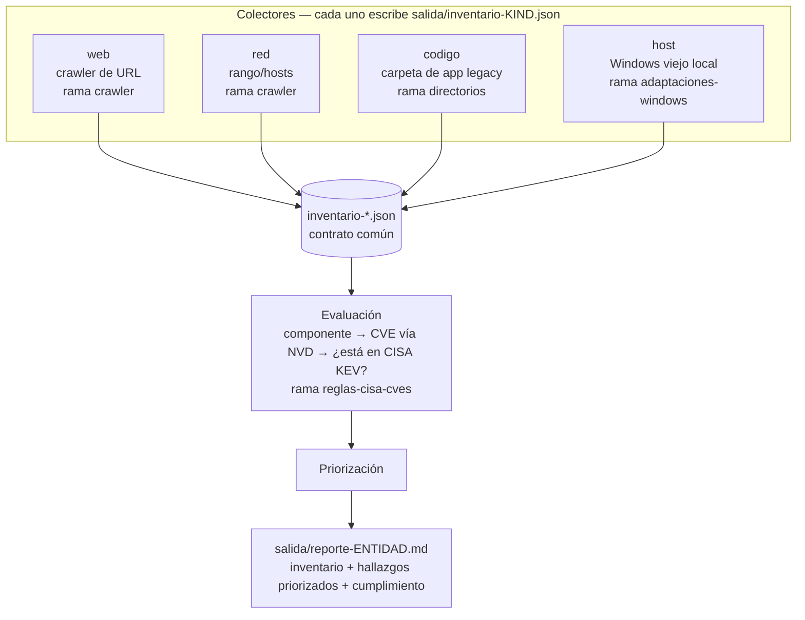

# ReVital — explicado para el equipo

> Documento de contexto para los 6 integrantes. Léelo completo una vez; después úsalo como referencia.
> Resumen visual de 1 hoja: [`ReVital-resumen-1-hoja.pdf`](ReVital-resumen-1-hoja.pdf).
> Fuente de verdad técnica: el `README.md` y `revital/inventory.py` de `main`. Si este documento y el código no coinciden, manda el código y se corrige este archivo.

---

## 1. La idea en una frase

**ReVital se suelta sobre una app, un servidor o una institución, documenta qué tecnología tiene (aunque sea vieja) y dice qué vulnerabilidades del catálogo CISA KEV hay que parchear primero.** Entrega un reporte `.md` por entidad con el inventario, los hallazgos priorizados y el estado de cumplimiento.

No toca, no reescribe y no reemplaza el sistema viejo: solo lo **mira** y lo **explica**.

---

## 2. ¿Qué problema resolvemos y para quién?

### El problema
Muchas oficinas públicas, municipalidades, clínicas y empresas en Guatemala dependen de sistemas de hace 10–20 años:

- **Nadie sabe qué tienen adentro.** El proveedor desapareció, no hay documentación, el que lo instaló ya no trabaja ahí.
- **No saben qué parchear.** Existen miles de CVE publicados; sin inventario es imposible saber cuáles les afectan.
- **No pueden reescribirlo.** No hay presupuesto ni tiempo; el sistema "funciona" y no se puede apagar.

El resultado: sistemas expuestos con vulnerabilidades que **ya se están explotando en el mundo real**, y nadie con la información para actuar.

### El usuario concreto
**El/la jefe(a) de TI de una municipalidad o entidad pública** que heredó un portal o servidor viejo sin documentación. Hoy, para saber "¿qué tengo y qué debo arreglar primero?", tendría que revisar a mano servidor por servidor y cruzar versiones contra bases de datos de vulnerabilidades. Con ReVital corre un comando y obtiene la respuesta en un reporte.

### La tarea que le devolvemos
> "Saber qué tecnología corre en mi institución y qué parchear primero, sin tocar ni romper lo que ya funciona."

---

## 3. ¿Por qué encaja en el Track 03 Legacy?

| Lo que pide el track | Cómo lo cumple ReVital |
|---|---|
| Conectar un sistema antiguo con tecnología actual | Conecta sistemas viejos con el catálogo actual de amenazas (CISA KEV / NVD) |
| Que alguien recupere una tarea | El jefe de TI recupera la tarea de inventariar y priorizar parches |
| Sin perder sus datos ni lo que ya tenía | Solo lectura: no modifica nada del sistema analizado |
| Traer la tecnología original, quién la usa y qué limitación resuelve | App legacy de prueba (ej. IIS 6 / ASP.NET, Apache viejo, jQuery 1.x) + jefe de TI + "no sabe qué tiene ni qué parchear" |
| **NO** rehacer el sistema desde cero con otra cara | No rehacemos nada: documentamos y recomendamos |
| "Ningún track se gana con un chatbot pegado encima" | El núcleo es determinístico: detección de versiones + cruce con catálogos. No es un chat |

---

## 4. Conceptos que todos deben dominar (glosario)

- **Legacy:** sistema viejo que sigue en producción, normalmente sin soporte ni documentación.
- **CVE** (*Common Vulnerabilities and Exposures*): identificador único de una vulnerabilidad pública, ej. `CVE-2021-41773`.
- **NVD** (*National Vulnerability Database*, NIST): base de datos que dice **qué productos y versiones** afecta cada CVE (mediante identificadores CPE) y su severidad (CVSS).
- **CISA KEV** (*Known Exploited Vulnerabilities*): lista de la agencia de ciberseguridad de EE. UU. con los CVE que **se sabe que están siendo explotados activamente**. Es un subconjunto pequeño de todos los CVE, por eso sirve para priorizar. Se publica como JSON: <https://www.cisa.gov/sites/default/files/feeds/known_exploited_vulnerabilities.json>. Campos útiles por entrada: `cveID`, `vendorProject`, `product`, `vulnerabilityName`, `dateAdded`, `shortDescription`, `requiredAction`, `dueDate`, `knownRansomwareCampaignUse`.
- **CPE:** nombre estandarizado de un producto/versión (ej. `cpe:2.3:a:apache:http_server:2.4.49`). Es el "puente" entre lo que detectamos y lo que dice NVD.
- **Colector:** módulo que inspecciona una fuente (web, red, carpeta, equipo) y produce un inventario.
- **Inventario:** lista de componentes detectados (`producto` + `version`) con el formato común del proyecto.
- **Entidad:** la institución analizada (ej. `MINFIN`, `MUNI-COBAN`); agrupa los reportes.

---

## 5. Arquitectura



Versión texto (por si el visor no muestra Mermaid):

```
 colectores (cada uno -> salida/inventario-<kind>.json)
   web     : crawler de URL                       (rama crawler)
   red     : rango/hosts de una institución       (rama crawler)
   codigo  : carpeta de una app legacy            (rama directorios)
   host    : equipo/servidor Windows viejo local  (rama adaptaciones-windows)
        │
        ▼
 evaluación: componentes -> CVE (NVD) -> ¿en CISA KEV?    (rama reglas-cisa-cves)
        │
        ▼
 reporte por entidad: salida/reporte-<entidad>.md
```

### Restricciones de diseño (no se negocian)
1. **Solo biblioteca estándar de Python 3.8+.** Nada de `pip install`. Razón: tiene que correr en el equipo viejo del cliente (Windows 7 incluido) donde no podemos instalar nada.
2. **Offline.** Los catálogos KEV y NVD se descargan antes y viajan con la herramienta. En la demo no dependemos del Wi-Fi.
3. **Solo lectura.** Ningún colector modifica el sistema analizado.
4. **Solo contra sistemas propios o con autorización.** Esto se dice también en el pitch.
5. Linux viejo: fuera de alcance por ahora.

---

## 6. El contrato común (lo más importante para que todo encaje)

Está en `revital/inventory.py`. **Todo colector produce exactamente esto** y nadie lee el JSON de otro más allá de estos campos:

```json
{
  "kind": "web | host | red | codigo",
  "target": "https://app.interna.gob  |  C:\\inetpub\\app  |  10.0.0.0/24",
  "entidad": "MUNI-COBAN",
  "generado": "2026-11-21 10:30:00",
  "components": [
    {"producto": "Microsoft-IIS", "version": "6.0", "fuente": "header Server", "donde": "https://app.interna.gob/"},
    {"producto": "jquery",        "version": "1.4.2", "fuente": "script src", "donde": "/js/jquery-1.4.2.min.js"}
  ],
  "extra": {}
}
```

- `producto`: nombre del componente. `version`: vacía si no se conoce.
- `fuente`: **cómo** lo detectamos (header, meta generator, nombre de archivo, pom.xml…). Esto es evidencia: el jurado puede preguntar "¿cómo sabes que es esa versión?".
- `donde`: **en qué lugar** (URL, ruta de archivo, host:puerto).
- `extra`: libre para cada colector (páginas, formularios, puertos…); la evaluación no depende de él.

Funciones disponibles: `nuevo(kind, target, entidad)`, `componente(producto, version, fuente, donde)`, `guardar(inv)` → `salida/inventario-<kind>.json`, `cargar_todos()` (lo usa la evaluación).

**Regla:** si alguien necesita cambiar el contrato, el cambio va **primero a `main`** y se avisa al equipo.

---

## 7. Qué hace cada pieza

### 7.1 Colector web — rama `crawler` (`revital/crawler.py`)
Ya existe. Recorre las páginas del mismo dominio y detecta tecnología por:
- headers `Server`, `X-Powered-By`, `X-AspNet-Version`, `X-AspNetMvc-Version`;
- `<meta name="generator">` (ej. `Joomla 1.5`);
- nombre de los scripts (`jquery-1.4.2.min.js` → jquery 1.4.2);
- extensión de las páginas (`.aspx` → ASP.NET WebForms, `.jsp`, `.php`, `.cfm`, `.do`…).

También detecta por **cookies de sesión** (`ASPSESSIONID`, `JSESSIONID`, `PHPSESSID`), **rutas típicas** (`WebResource.axd`, `/struts/`, `/wp-content/`), **comentarios HTML** y **páginas de error** (ej. `Apache Tomcat/5.5.23` en un 404).

También lista formularios y sus campos (útil para documentar la app) y los documentos enlazados (PDF, DOC, XLS…). Opciones: `--insecure` (servidores viejos con TLS 1.0 o certificados vencidos), `--entidad`, `--scope host2,host3` (hosts permitidos; no sigue redirects fuera de scope), `--timeout`, `--demo` (autoprueba sin red). Usa `robots.txt` (los `Disallow` suelen apuntar a `/admin`, `/backup`) y `sitemap.xml` como fuentes de rutas. Evita trampas (ids de sesión en URL, tope de 5 páginas por patrón), reintenta fallos de red y guarda lo recorrido si se interrumpe con Ctrl+C.

> ✅ **Integrado al contrato:** el crawler ya usa `inventory.nuevo(...)`/`componente(...)` y escribe `salida/inventario-web.json` con `producto` y `version` separados, más `salida/reporte-<entidad>-web.md`. Pruebas: `python -m revital.crawler --demo` y `python tests/test_crawler_local.py` (sitio falso legacy local, sin internet).
>
> Pendiente del colector: charset real de las páginas, cascada de versiones TLS (con `adaptaciones-windows`), login y JavaScript.

### 7.2 Colector de red — rama `crawler` (`revital/red.py`)
Recorre un rango o lista de hosts de la institución y toma banners de servicios (versión de servidor web, etc.). Produce `inventario-red.json`.

### 7.3 Colector de código/carpeta — rama `directorios` (`revital/codigo.py`)
Se apunta a la carpeta de una app legacy y lee archivos que declaran versiones:
- `web.config` (versión de .NET Framework), DLLs y sus versiones;
- `pom.xml` (dependencias Java: aquí aparecería, por ejemplo, un Log4j viejo);
- `composer.json` (PHP), `package.json` (JS), etc.

Produce `inventario-codigo.json`. Es el colector con la evidencia más precisa porque lee versiones declaradas, no adivinadas.

### 7.4 Colector de host — rama `adaptaciones-windows` (`revital/host.py`, `scripts/`)
Corre en el propio equipo/servidor Windows viejo: software instalado, versión de Windows/IIS, etc. Incluye un `.bat` para lanzarlo fácil y las adaptaciones para TLS y Python viejos. Produce `inventario-host.json`.

### 7.5 Evaluación y reporte — rama `reglas-cisa-cves` (`revital/cves/`)
1. **Carga** todos los `inventario-*.json` con `cargar_todos()`.
2. **Normaliza** cada `producto`+`version` a algo comparable (idealmente CPE).
3. **Busca CVE** que afecten esa versión en la copia offline de NVD.
4. **Marca** cuáles de esos CVE están en **CISA KEV** (explotados activamente).
5. **Prioriza** (propuesta, a confirmar por quien lleve la rama):
   1. En KEV **y** `knownRansomwareCampaignUse = "Known"`;
   2. En KEV con `dueDate` ya vencida;
   3. En KEV;
   4. No está en KEV, ordenado por severidad CVSS.
6. **Genera** `salida/reporte-<entidad>.md` con: inventario (con fuente y dónde), hallazgos priorizados (CVE, producto afectado, por qué es prioritario, `requiredAction` de CISA) y resumen de cumplimiento (cuántos KEV abiertos).

> Nota honesta: el cruce producto→CVE es la parte más difícil (los nombres detectados no siempre coinciden con los de NVD). Para la demo conviene una **tabla de alias** pequeña y controlada para los productos de nuestra app de prueba.

---

## 8. Cómo trabajamos en el repo

| Rama | Carpeta/archivo que toca | Qué |
|---|---|---|
| `crawler` | `revital/crawler.py`, `revital/red.py` | Colector web y de red |
| `directorios` | `revital/codigo.py` (+ `docs/` para documentación compartida) | Colector de carpeta/app |
| `adaptaciones-windows` | `revital/host.py`, `scripts/` | Colector de equipo Windows viejo |
| `reglas-cisa-cves` | `revital/cves/` | Catálogos offline, cruce, prioridad, reporte |

- **Cada rama toca solo su carpeta.** Así no hay conflictos.
- Ramas cortas, **PR a `main`**, commits pequeños.
- Cambios al contrato (`inventory.py`) primero a `main`.
- Documentación compartida del equipo: carpeta `docs/` en la rama `directorios`.

### Uso esperado
```
python -m revital.crawler https://app.interna.gob --insecure --entidad MUNI-COBAN
python -m revital.crawler --demo        # autocomprobación sin red
```

---

## 9. La demo (lo que verá el jurado)

Regla del evento: **"se enseña lo que funciona"**. Guion sugerido (≈90 s):

1. **Dolor (15 s):** "Esta es la app de una municipalidad: IIS/Apache viejo, sin documentación, nadie sabe qué tiene. ¿Qué parchean primero?"
2. **Documentar (25 s):** corremos los colectores sobre la app legacy de prueba (en local, sin internet). Aparece el inventario: producto, versión, cómo lo supimos y dónde.
3. **Priorizar (30 s):** la evaluación cruza contra CISA KEV. Mostramos el reporte: "de N componentes, estos 2 tienen vulnerabilidades que se están explotando hoy; esta es la acción requerida y la fecha límite de CISA".
4. **Prueba de que no tocamos nada (10 s):** hash del sistema antes y después: idéntico.
5. **Cierre (10 s):** "Esto es el paso 0 de cualquier transformación digital: no puedes modernizar lo que no sabes que tienes."

**Preparar antes:**
- App legacy de prueba en local (contenedor o carpeta) con versiones viejas conocidas que **sí** estén en KEV.
- Catálogo KEV y extracto de NVD descargados y congelados en el repo/USB.
- Reporte de ejemplo ya generado como respaldo, y video de respaldo.
- Todo probado en **modo avión**.

---

## 10. Preguntas que nos puede hacer el jurado (y respuesta corta)

- **"¿Eso no lo hace ya Nessus/OpenVAS/Trivy?"** → Son herramientas pesadas, de pago o que requieren instalar dependencias/infraestructura. ReVital corre con Python puro en el equipo viejo del cliente, offline, y prioriza solo con lo que **ya se está explotando** (KEV), en un reporte que entiende un jefe de TI.
- **"¿Cómo saben la versión?"** → Cada componente trae `fuente` y `donde`: evidencia rastreable.
- **"¿Y si la versión no se puede detectar?"** → Se reporta el componente con versión desconocida y se marca para revisión manual; no inventamos.
- **"¿Es legal escanear?"** → Solo sobre sistemas propios o con autorización por escrito.
- **"¿Dónde está la IA?"** → El núcleo es determinístico a propósito (confiable y auditable). La IA puede entrar como apoyo para redactar el resumen ejecutivo o normalizar nombres de productos, nunca para decidir solos qué es vulnerable.

---

## 11. Riesgos y cómo los cubrimos

| Riesgo | Mitigación |
|---|---|
| El cruce producto→CVE no encuentra coincidencias | Tabla de alias controlada para la demo; probar temprano con la app de prueba |
| Cada colector entrega un formato distinto | Contrato único en `inventory.py`; `crawler` ya adaptado; `codigo` y `host` deben usarlo igual |
| Sin internet en la UVG | Catálogos offline, todo local |
| Querer cubrir todo (4 colectores) y no cerrar ninguno | Prioridad: **web + código + evaluación + reporte** funcionando de punta a punta; red y host después |
| Afirmar datos que no podemos sostener | En el pitch solo citamos cifras con fuente primaria verificada |

---

## 12. Hoja de ruta (después del MVP)

Esto viene de la idea "Escudo Legacy 3 Capas" que analizamos antes; **no es parte del MVP de hoy**:

- **Fase 2 — Parche virtual:** un proxy delante del sistema viejo que bloquea el vector de ataque del CVE detectado, sin tocar el sistema (probado con exploit → `403` y uso normal → `200`).
- **Fase 3 — Monitoreo y cumplimiento:** panel con intentos bloqueados por CVE, rollback y exportación de reporte de incidente.
- Soporte para Linux viejo.

---

## 13. Checklist rápido para cada integrante

- [ ] Leí este documento y el `README.md`.
- [ ] Sé qué rama es la mía y qué carpeta toco.
- [ ] Mi colector produce el contrato de `inventory.py` (probado con `python -m ...`).
- [ ] Mi código usa solo la biblioteca estándar y corre en Python 3.8.
- [ ] Funciona sin internet.
- [ ] Hice PR a `main` con commits pequeños.
