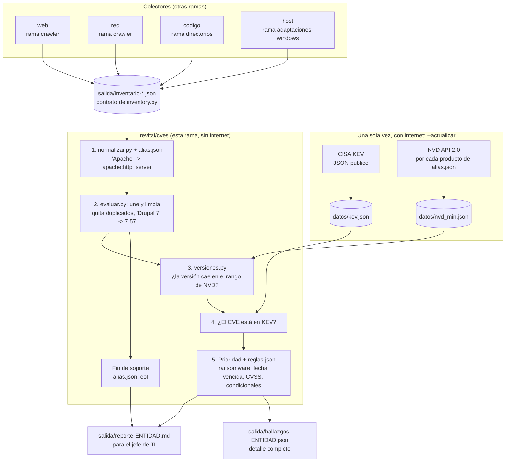

# Rama `reglas-cisa-cves`: contexto

> Documento de la rama `reglas-cisa-cves` (carpeta `revital/cves/`). Explica qué hace, por qué está hecha así y cómo encaja con el resto de ReVital.
> Contexto general del proyecto: [`docs/ReVital-explicado.md`](../../docs/ReVital-explicado.md). Uso rápido: [`LEEME.md`](LEEME.md).
> Si este documento y el código no coinciden, manda el código.

---

## 1. Qué hace, en una frase

**Toma lo que encontraron los colectores ("hay Apache 2.4.49 y Drupal 7.57"), averigua qué vulnerabilidades tiene cada versión, marca las que se están explotando en el mundo real (CISA KEV) y escribe el reporte final por entidad con lo que hay que parchear primero.**

Los colectores responden *"¿qué tengo?"*. Esta rama responde *"¿qué arreglo primero y por qué?"*.

---

## 2. Diagrama



Versión texto (por si el visor no muestra Mermaid):

```
 colectores ──► salida/inventario-*.json
                        │
                        ▼
   1. normalizar   'Apache' / 'apache http_server' ──► apache:http_server   (alias.json)
   2. unir         mismo producto+versión de varias fuentes = 1 fila; 'Drupal 7' se descarta si se sabe 7.57
   3. versiones    ¿2.4.49 está dentro del rango afectado?                   (datos/nvd_min.json)
   4. KEV          ¿ese CVE se está explotando?                               (datos/kev.json)
   5. prioridad    KEV+ransomware > KEV vencido > KEV > CVSS≥9 > CVSS≥7 > resto (reglas.json)
                        │
                        ▼
   salida/reporte-<entidad>.md  +  salida/hallazgos-<entidad>.json
```

---

## 3. Entrada: el contrato común

No leemos nada propio de cada colector. Solo el contrato de `revital/inventory.py`, que se carga con `inventory.cargar_todos("salida")`:

```json
{"kind": "web", "target": "http://localhost:8080", "entidad": "Muni San Ejemplo",
 "components": [{"producto": "Apache", "version": "2.4.49", "fuente": "header server en error 400", "donde": "localhost:8080"}]}
```

- Se hace **un reporte por cada `entidad`** distinta que haya en `salida/`. Si varios colectores apuntan a la misma entidad (web + código + host), sus componentes se unen en un solo reporte.
- `fuente` y `donde` se conservan hasta el final como **evidencia**: el jurado puede preguntar "¿cómo sabes que es esa versión?".

---

## 4. Las fuentes de datos y por qué hacen falta las dos

| Fuente | Qué responde | Qué NO trae | Archivo |
|---|---|---|---|
| **NVD** (NIST) | Qué versiones afecta cada CVE (CPE + rangos) y qué tan grave es (CVSS) | Si se está explotando | `datos/nvd_min.json` |
| **CISA KEV** | Qué CVE se explotan activamente, si los usa ransomware, acción requerida y fecha límite | Qué versiones afecta | `datos/kev.json` |

KEV dice "este CVE de Apache se explota" pero no dice "hasta qué versión". NVD dice "afecta hasta 2.4.48" pero no dice si es urgente. **Juntas responden "¿mi versión tiene algo que se esté explotando hoy?".**

**¿Por qué no una base de datos?** Restricción del proyecto: solo stdlib de Python 3.8, offline, en Windows 7. Son archivos JSON (unos 10 MB en total) que se cargan en memoria en menos de un segundo. Si algún día se quiere todo NVD, el siguiente paso es `sqlite3`, que también es stdlib.

**Offline:** `--actualizar` se corre una vez en una máquina con internet y la carpeta `datos/` viaja en USB. Si `datos/` está vacía, se usan los catálogos reducidos de `ejemplos/` y el reporte lo avisa arriba.

---

## 5. Decisiones de diseño (y por qué)

| Decisión | Por qué |
|---|---|
| **Tabla de alias** (`alias.json`) en vez de adivinar nombres | Los colectores escriben "Apache", "Microsoft-IIS", "apache http_server"; NVD usa `apache:http_server`. El docs del equipo ya lo marcaba como la parte más difícil. Agregar un producto = editar JSON, no código. |
| **Versiones como números**, no texto | Como texto `"10.0" < "9.9"`. Además: `1.3.3c > 1.3.3` (ProFTPD, OpenSSL) y `7.5-beta < 7.5`. |
| **Versión incompleta = "posible"** | El meta generator dice "Drupal 7"; con eso no se puede confirmar nada. Si otra fuente dio 7.57, se usa esa y la evidencia de "Drupal 7" se une a la fila de 7.57. Si solo hay "7", se listan solo los KEV de la rama como "posibles". |
| **Sin versión = revisión manual** | No inventamos. Se dice cuántos KEV tiene el producto para que alguien lo revise a mano. |
| **CVE condicionales aparte** (`reglas.json`) | Algunos CVE solo aplican con cierta configuración que no se ve desde fuera (ej. CVE-2024-38475, reglas de mod_rewrite). Se reportan como "verificar", no como confirmados. |
| **Fin de soporte (EOL)** separado de los CVE | Un Drupal 7 no recibirá más parches: la recomendación no es "parchar" sino "planificar migración". Importante para gobierno. |
| **Solo lectura** | Nunca se descargan ni ejecutan exploits; solo se leen catálogos públicos. |

---

## 6. Prioridad

| Nivel | Etiqueta | Regla |
|---|---|---|
| 1 | CRITICO | En KEV **y** `knownRansomwareCampaignUse = "Known"` |
| 2 | URGENTE (vencido) | En KEV y ya pasó la `dueDate` de CISA |
| 3 | URGENTE | En KEV |
| 4 | ALTO | No está en KEV, CVSS ≥ 9.0 |
| 5 | MEDIO | No está en KEV, CVSS ≥ 7.0 |
| 6 | BAJO | Resto |

Dentro de cada nivel se ordena por CVSS. Los umbrales están en `reglas.json`. Es la prioridad que propone `docs/ReVital-explicado.md` (sección 7.5).

---

## 7. Salida: el reporte final

`salida/reporte-<entidad>.md`, pensado para un jefe de TI:

1. **Resumen** con indicadores y estado de **cumplimiento** ("NO CUMPLE: N vulnerabilidades KEV sin parchear").
2. **Qué parchear primero:** solo KEV, con motivo, acción requerida por CISA, fecha límite y evidencia.
3. **Dependen de configuración** (verificar).
4. **Fuera de soporte** (planificar migración).
5. **Otras vulnerabilidades** no KEV (las 20 más graves; el resto en el `.json`).
6. **Revisión manual:** sin versión, versión incompleta, productos sin alias.
7. **Inventario** completo con fuente y dónde, y el método usado.

`salida/hallazgos-<entidad>.json` trae todo el detalle, para un dashboard u otra herramienta.

---

## 8. Resultado con el caso de demo (portal-muni-gt)

Entrada: salida real del crawler contra el Docker de `casos/portal-muni-gt` (Drupal 7.57 detrás de un proxy Apache 2.4.49, backend Apache 2.4.10, PHP 7.0.28). Catálogos reales: **KEV versión 2026.11.20 (1,790 vulnerabilidades)** y NVD de los 18 productos de `alias.json`, descargados el 21-nov-2026.

**4 componentes · 10 KEV abiertos (5 usados en ransomware) · 292 otras CVE · 2 a verificar · 2 fuera de soporte**

| Prioridad | CVE | Componente |
|---|---|---|
| CRITICO | CVE-2018-7600 (Drupalgeddon 2) | Drupal 7.57 |
| CRITICO | CVE-2018-7602 (Drupalgeddon 3) | Drupal 7.57 |
| CRITICO | CVE-2021-41773 | Apache 2.4.49 (proxy) |
| CRITICO | CVE-2021-42013 | Apache 2.4.49 (proxy) |
| CRITICO | CVE-2021-40438 | Apache 2.4.10 (backend) |
| URGENTE (vencido) | CVE-2020-13671 | Drupal 7.57 |
| URGENTE (vencido) | CVE-2026-109619 | PHP 7.0.28 (agregado a KEV el 26-oct-2026) |
| URGENTE (vencido) | CVE-2020-28949 | Drupal 7.57 (librería incluida) |
| URGENTE (vencido) | CVE-2020-36193 | Drupal 7.57 (librería incluida) |
| URGENTE (vencido) | CVE-2020-11023 | Drupal 7.57 (jQuery incluido) |

Fuera de soporte: Drupal 7 (desde 2025-01-05) y PHP 7.0 (desde 2019-01-10).

Para el pitch: **un sistema "que funciona" sigue acumulando vulnerabilidades explotadas**; la de PHP entró a KEV hace menos de un mes.

### Diferencias encontradas con `casos/portal-muni-gt` (para quien mantiene el caso)
- **CVE-2021-42013** sí aplica a 2.4.49, no "solo si 2.4.50": NVD lista 2.4.49 y 2.4.50.
- **CVE-2019-6340** no aplica: NVD solo lista Drupal 8.5.x y 8.6.x.
- **CVE-2024-38475** también toca al proxy 2.4.49 (afecta a 2.4.0 hasta antes de 2.4.60), no solo al backend.
- KEV real agrega **CVE-2018-7602** y **CVE-2021-40438** como críticos, que el caso no listaba.

---

## 9. Cómo se usa

```
python -m revital.cves --demo                 # caso de ejemplo, sin red; termina en "ok"
python -m revital.cves --out salida           # lee salida/inventario-*.json -> salida/reporte-<entidad>.md
python -m revital.cves --out salida --entidad "Muni San Ejemplo"
python -m revital.cves --actualizar           # baja KEV + NVD a datos/ (requiere internet; tarda unos minutos)
python -m revital.cves --actualizar --productos php,drupal   # solo algunos productos
python tests/test_cves.py                     # pruebas (sin pytest)
```

`--demo` siempre usa los catálogos de `ejemplos/`, a propósito, para que la prueba dé siempre el mismo resultado. Con `NVD_API_KEY` en el entorno, `--actualizar` va más rápido.

---

## 10. Archivos

| Archivo | Qué hace |
|---|---|
| `__main__.py` | Línea de comandos: `--demo`, `--out`, `--entidad`, `--actualizar` |
| `normalizar.py` + `alias.json` | Nombre del colector → CPE de NVD; ramas fuera de soporte |
| `versiones.py` | Comparación de versiones y rangos de NVD |
| `catalogo.py` | Carga KEV/NVD offline; convierte respuestas crudas del API de NVD; `--actualizar` |
| `evaluar.py` + `reglas.json` | Une componentes, cruza, prioriza; CVE condicionales y umbrales |
| `reporte.py` | Escribe el `.md` y el `.json` |
| `ejemplos/` | Inventario real del crawler (caso Drupal) + KEV y NVD reducidos |
| `datos/` | Catálogos reales (los llena `--actualizar`) |
| `../../tests/test_cves.py` | Pruebas: versiones, alias, conversión de NVD, caso Drupal completo |

---

## 11. Cómo extenderlo

- **Nuevo producto:** agregarlo a `alias.json` con los nombres que usan los colectores y su CPE de NVD (se busca en <https://nvd.nist.gov/products/cpe/search>), después `--actualizar --productos <nombre>`.
- **Nuevo CVE condicional:** agregarlo a `reglas.json > condicionales` con el texto de qué verificar.
- **Coordinación con los colectores:** si un colector emite un nombre nuevo, aparece en el reporte bajo "Sin equivalencia en NVD"; ahí se ve qué falta en `alias.json`.

---

## 12. Pendiente

- [ ] **Exploit-DB** como señal extra: "no está en KEV pero hay exploit público" como nivel entre KEV y CVSS. Se usaría su índice CSV offline; nunca se descargan exploits.
- [ ] Ampliar `alias.json` con lo que emitan los colectores `codigo` (pom.xml, composer.json, DLLs) y `host` (software instalado en Windows).
- [ ] EPSS (probabilidad de explotación, de FIRST) como desempate dentro de un mismo nivel.
- [ ] Decidir con el equipo si `datos/kev.json` y `datos/nvd_min.json` (unos 10 MB) se suben al repo para que la demo funcione sin internet desde cualquier laptop.
- [ ] Probar con Python 3.8 en Windows 7 real antes de la demo.

---

## 13. Limitaciones (dicho con honestidad)

- **Depende de que el colector detecte bien la versión.** Si la versión es falsa o está oculta, el resultado también lo estará; por eso cada hallazgo trae su evidencia.
- **Backports:** algunas distribuciones parchean sin cambiar el número de versión. Un hallazgo "confirmado" significa "la versión reportada está en el rango afectado", no "se explotó con éxito".
- **CVE que dependen de configuración** no se pueden confirmar desde fuera; van en su propia sección.
- **Los nombres de NVD cambian** (ej. nginx pasó de `nginx:nginx` a `f5:nginx`); `alias.json` admite varios CPE por producto por eso.
